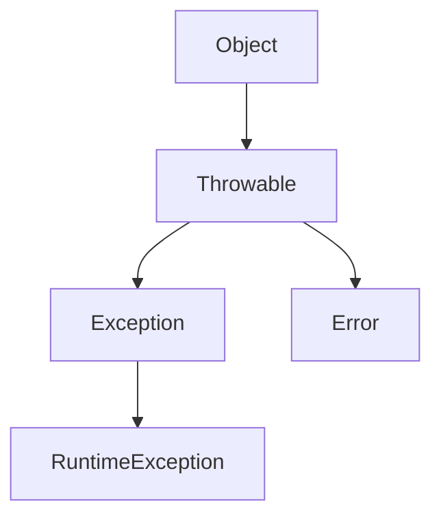

# Java Exception Handling
> Complete Beginner to Advanced Guide with VS Code Examples

---

## 📚 Table of Contents

- [1. Introduction](#1-introduction)
- [2. What is an Exception?](#2-what-is-an-exception)
- [3. Exception Hierarchy](#3-exception-hierarchy)
- [4. Types of Exceptions](#4-types-of-exceptions)
- [5. try-catch](#5-try-catch)
- [6. finally](#6-finally)
- [7. throw](#7-throw)
- [8. throws](#8-throws)
- [9. Custom Exceptions](#9-custom-exceptions)
- [10. Exception Propagation](#10-exception-propagation)
- [11. Try-With-Resources](#11-try-with-resources)
- [12. Best Practices](#12-best-practices)
- [13. Interview Questions](#13-interview-questions)

---

# 1. Introduction

Exception Handling is Java's mechanism for handling runtime errors while keeping the application running.

### Why do we need it?

Without exception handling:

```java
int result = 10 / 0;
```

Application crashes.

With exception handling:

```java
try {
    int result = 10 / 0;
}
catch (ArithmeticException e) {
    System.out.println("Cannot divide by zero");
}
```

Application continues safely.

---

# 2. What is an Exception?

An exception is an event that interrupts the normal execution of a program.

## Example

```java
public class Main {
    public static void main(String[] args) {
        int result = 10 / 0;
    }
}
```

### Output

```text
Exception in thread "main"
java.lang.ArithmeticException: / by zero
```

---

# 3. Exception Hierarchy



## Understanding Hierarchy

### Throwable

Root class for all errors and exceptions.

### Error

Serious JVM-related problems.

Examples:

- OutOfMemoryError
- StackOverflowError

### Exception

Problems that applications can handle.

---

# 4. Types of Exceptions

## Checked Exceptions

Checked during compilation.

Examples:

```java
IOException
SQLException
FileNotFoundException
```

### Example

```java
FileReader file =
    new FileReader("data.txt");
```

Compilation fails unless handled.

---

## Unchecked Exceptions

Checked during runtime.

Examples:

```java
ArithmeticException
NullPointerException
NumberFormatException
```

### Example

```java
String s = null;
System.out.println(s.length());
```

Output:

```text
NullPointerException
```

---

# 5. try-catch

## Syntax

```java
try {
    // risky code
}
catch(ExceptionType e) {

}
```

## Example

```java
try {
    int value = 10 / 0;
}
catch(ArithmeticException e) {
    System.out.println("Division by zero");
}
```

### Output

```text
Division by zero
```

---

# 6. finally

The finally block executes regardless of exception occurrence.

```java
try {
    System.out.println("Try");
}
finally {
    System.out.println("Finally");
}
```

Output:

```text
Try
Finally
```

### Common Uses

✅ Closing files

✅ Closing database connections

✅ Releasing resources

---

# 7. throw

Used to manually create an exception.

```java
throw new ArithmeticException(
    "Age is invalid");
```

### Example

```java
int age = 15;

if(age < 18) {
    throw new IllegalArgumentException(
        "Age must be 18+");
}
```

---

# 8. throws

Used in method declarations.

```java
public void readFile()
        throws IOException
{
}
```

### Why?

It informs callers that the method may generate exceptions.

---

# 9. Custom Exceptions

## Step 1

Create custom exception class.

```java
class InvalidAgeException
        extends Exception {

    public InvalidAgeException(
            String message) {

        super(message);
    }
}
```

## Step 2

Use custom exception.

```java
if(age < 18) {
    throw new InvalidAgeException(
        "Must be 18+");
}
```

---

# 10. Exception Propagation

```java
main()
  ↓
method1()
  ↓
method2()
  ↓
method3()
```

If method3 throws an exception, it travels upward until handled.

### Example

```java
static void method3() {
    int x = 10 / 0;
}
```

---

# 11. Try-With-Resources

Introduced in Java 7.

```java
try(FileReader fr =
        new FileReader("abc.txt")) {

    // work
}
catch(IOException e) {

}
```

Resource automatically closes.

### Benefits

- Cleaner code
- No finally block needed
- Prevents memory leaks

---

# 12. Best Practices

## ✅ Do

### Catch Specific Exceptions

```java
catch(IOException e)
```

### Use Meaningful Messages

```java
throw new IllegalArgumentException(
    "Age cannot be negative");
```

### Use Try-With-Resources

```java
try(FileReader file =
    new FileReader("test.txt"))
```

---

## ❌ Avoid

### Empty Catch Blocks

```java
catch(Exception e) {
}
```

### Catching Generic Exception Everywhere

```java
catch(Exception e)
```

---

# 13. Interview Questions

## Difference Between Error and Exception

| Error | Exception |
|---------|---------|
| Serious problem | Recoverable problem |
| JVM related | Application related |
| Usually not handled | Commonly handled |

---

## Difference Between throw and throws

| throw | throws |
|---------|---------|
| Used inside method | Used in method signature |
| Creates exception | Declares exception |
| Exception object | Exception class |

---

## What is Exception Propagation?

The process of transferring an exception from one method to its caller until it is handled.

---

# Quick Revision Sheet

✅ try

✅ catch

✅ finally

✅ throw

✅ throws

✅ Checked Exceptions

✅ Unchecked Exceptions

✅ Custom Exceptions

✅ Try-With-Resources

✅ Exception Propagation

✅ Best Practices

✅ Interview Questions

---

## VS Code Execution

Compile:

```bash
javac Main.java
```

Run:

```bash
java Main
```

Check Java Version:

```bash
java -version
javac -version
