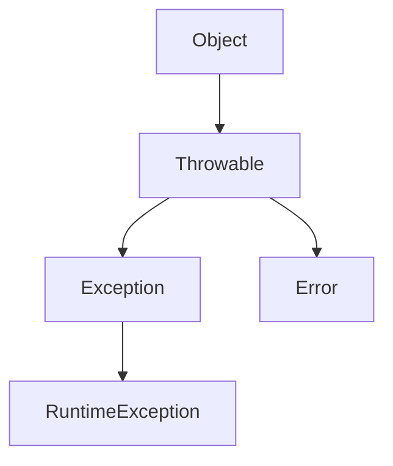

<<<<<<< HEAD
# Java Exception Handling - Complete Notes

## Table of Contents

1. Introduction to Exception Handling
2. What is an Exception?
3. Why Exception Handling?
4. Exception Hierarchy
5. Types of Exceptions
6. Checked Exceptions
7. Unchecked Exceptions
8. Error vs Exception
9. try-catch Block
10. Multiple Catch Blocks
11. Nested try Blocks
12. finally Block
13. try-catch-finally
14. Exception Object Methods
15. throw Keyword
16. throws Keyword
17. throw vs throws
18. Custom Exceptions
19. Multi-Catch Block
20. Try-With-Resources
21. Exception Propagation
22. Common Java Exceptions
23. Best Practices
24. Interview Questions
25. Real-World Banking Project

---

# 1. Introduction to Exception Handling

Exception Handling is a mechanism in Java that allows a program to handle runtime errors gracefully and continue execution without abruptly terminating.

Problems may occur because of:

- Invalid user input
- Missing files
- Database failures
- Division by zero
- Network issues

Java provides a robust exception handling framework through:

- try
- catch
- finally
- throw
- throws

---

# 2. What is an Exception?

An Exception is an abnormal condition that occurs during program execution and disrupts the normal flow of the program.

Example:

```java
public class Main {

    public static void main(String[] args) {

        int result = 10 / 0;

        System.out.println(result);
    }
}
```

Output:

```text
Exception in thread "main"
java.lang.ArithmeticException: / by zero
```

The program terminates because the exception is not handled.

---

# 3. Why Exception Handling?
=======
# Java Exception Handling
> Complete Beginner to Advanced Guide with VS Code Examples

---

## 📚 Table of Contents

- [1. Introduction](#1-introduction)
- [2. What is an Exception?](#2-what-is-an-exception)
- [3. Exception Hierarchy](#3-exception-hierarchy)
- [4. Types of Exceptions](#4-types-of-exceptions)
- [5. try-catch](#5-try-catch)
- [6. finally](#6-finally)
- [7. throw](#7-throw)
- [8. throws](#8-throws)
- [9. Custom Exceptions](#9-custom-exceptions)
- [10. Exception Propagation](#10-exception-propagation)
- [11. Try-With-Resources](#11-try-with-resources)
- [12. Best Practices](#12-best-practices)
- [13. Interview Questions](#13-interview-questions)

---

# 1. Introduction

Exception Handling is Java's mechanism for handling runtime errors while keeping the application running.

### Why do we need it?
>>>>>>> 7902fbb586a7c50161af6fa51855a1714e639a95

Without exception handling:

```java
<<<<<<< HEAD
public class Main {

    public static void main(String[] args) {

        int result = 10 / 0;

        System.out.println("Program Continues");
    }
}
```

Program crashes.

With exception handling:

```java
public class Main {

    public static void main(String[] args) {

        try {
            int result = 10 / 0;
        }

        catch (ArithmeticException e) {
            System.out.println("Cannot divide by zero");
        }

        System.out.println("Program Continues");
    }
}
```

Output:

```text
Cannot divide by zero
Program Continues
```

Benefits:

- Prevents application crashes
- Improves reliability
- Enables proper error reporting
- Enhances debugging

---

# 4. Exception Hierarchy

```text
Object
   |
Throwable
   |
   +---------------------+
   |                     |
Exception             Error
   |
   +---------------------+
   |                     |
Checked         RuntimeException
Exceptions             |
                         |
                Unchecked Exceptions
```

Important Classes:

- Throwable
- Exception
- RuntimeException
- Error

---

# 5. Types of Exceptions

Java exceptions are mainly classified into:

## 1. Checked Exceptions

Checked during compilation.

Examples:

- IOException
- SQLException
- FileNotFoundException
- ClassNotFoundException

## 2. Unchecked Exceptions

Checked during runtime.

Examples:

- ArithmeticException
- NullPointerException
- NumberFormatException
- ArrayIndexOutOfBoundsException

---

# 6. Checked Exceptions

Compiler forces handling.

Example:

```java
import java.io.FileReader;

public class Main {

    public static void main(String[] args) {

        FileReader fr =
                new FileReader("data.txt");
    }
}
```

Compilation Error:

```text
Unhandled exception type FileNotFoundException
```

Solution:

```java
import java.io.*;

public class Main {

    public*static void main(String[] args) {
*        try {
            FileRead*r fr =
                    new Fil*Reader("data.txt");
        }

   *    catch(FileNotFoundException e)*{
            System.out.println("*ile not found");
        }
    }
}*```

---

# 7. Unchecked Exception*

Compiler does not check them.

E*ample:

```java
public class Main *

    public static void main(Stri*g[] args) {

        int[] arr = {*0,20,30};

*       System.out.println(arr[5]);*    }
}
```

Output:

```text
Arra*IndexOutOfBoundsException
```

---*
# 8. Error vs Exception

| Error * Exception |
|---------|----------*-|
| Serious problem | Recoverable*problem |
| Not handled normally |*Can be handled |
| Caused by syste* | Caused by application |
| OutOf*emoryError | IOException |

Exampl*:

```java
StackOverflowError
```
*```java
IOException
```

---

# 9.*try-catch Block

Basic syntax:

``*java
try {
    // risky code
}

ca*ch(ExceptionType e) {
    // handl*ng code
}
```

Example:

```java
p*blic class Main {

    public stat*c void main(String[] args) {

    *   try {
            int result = *0 / 0;
        }

        catch(Ar*thmeticException e) {
            *ystem.out.println("Division by zer*");
        }
    }
}
```

Output:*
```text
Division by zero
```

---*
# 10. Multiple Catch Blocks

Used*for handling different exceptions *eparately.

```java
public class M*in {

    public static void main(*tring[] args) {

        try {

  *         int[] arr = {1,2,3};

   *        System.out.println(arr[5])*

        }

        catch(Arithme*icException e) {
            Syste*.out.println("Arithmetic Error");
*       }

        catch(ArrayIndex*utOfBoundsException e) {
         *  System.out.println("Array Index *rror");
        }
    }
}
```

Out*ut:

```text
Array Index Error
```*
---

# 11. Nested try Blocks

A t*y block inside another try block.
*```java
public class Main {

    p*blic static void main(String[] arg*) {

        try {

            tr* {
                int result = 10*/ 0;
            }

            ca*ch(ArithmeticException e) {
      *         System.out.println("Inner*Catch");
            }

        }
*        catch(Exception e) {
     *      System.out.println("Outer Ca*ch");
        }
    }
}
```

Outpu*:

```text
Inner Catch
```

---

#*12. finally Block

The finally blo*k always executes whether exceptio* occurs or not.

Syntax:

```java
*ry {

}
catch(Exception e) {

}
fi*ally {

}
```

Example:

```java
t*y {

    int result = 10 / 0;

}

*atch(ArithmeticException e) {

   *System.out.println("Handled");

}
*finally {

    System.out.println(*Always Executes");
}
```

Output:
*```text
Handled
Always Executes
``*

Uses:

- Closing files
- Closing*sockets
- Closing database connect*ons

---

# 13. try-catch-finally
*Example:

```java
public class Mai* {

    public static void main(St*ing[] args) {

        try {

    *       System.out.println("Try");
*            int result = 10 / 0;

*       }

        catch(Arithmetic*xception e) {

            System.*ut.println("Catch");

        }

 *      finally {

            Syste*.out.println("Finally");

        *
    }
}
```

Output:

```text
Try*Catch
Finally
```

---

# 14. Exce*tion Object Methods

## getMessage*)

Returns only the exception mess*ge.

```java
catch(Exception e) {
*   System.out.println(e.getMessage*));
}
```

Output:

```text
/ by z*ro
```

---

## toString()

```jav*
System.out.println(e.toString());
```

Output:

```text
java.lang.ArithmeticException: / by zero
```

---

## printStackTrace()

```java
e.printStackTrace();
```

Output:

```text
java.lang.ArithmeticException
at Main.main(Main.java:5)
```

---

# 15. throw Keyword

Used to explicitly throw an exception.

Syntax:

```java
throw new ExceptionType("message");
```

Example:

```java
public class Main {

    public static void main(String[] args) {

        int age = 15;

        if(age < 18) {

            throw new ArithmeticException(
                    "Not Eligible");
        }
    }
}
```

Output:

```text
ArithmeticException: Not Eligible
```

---

# 16. throws Keyword

Used in method declaration.

Syntax:

```java
returnType method() throws ExceptionName
```

Example:

```java
import java.io.*;

public class Main {

    static void readFile()
            throws IOException {

        FileReader fr =
                new FileReader("data.txt");
    }

    public static void main(String[] args) {

        try {

            readFile();

        }

        catch(IOException e) {

            System.out.println("File Error");
        }
    }
}
```

---

# 17. Difference Between throw and throws

| throw | throws |
|---------|---------|
| Used inside method | Used in signature |
| Throws exception object | Declares exception class |
| Single exception | Multiple exceptions |
| Runtime action | Compile-time declaration |

Example:

```java
throw new ArithmeticException();
```

Example:

```java
public void test()
        throws IOException
```

---

# 18. Custom Exceptions

Create application-specific exceptions.

## Step 1

Create custom class.

```java
class InvalidAgeException extends Exception {

    public InvalidAgeException(String msg) {

        super(msg);
    }
}
```

## Step 2

Use custom exception.

```java
public class Main {

    static void checkAge(int age)
            throws InvalidAgeException {

        if(age < 18) {

            throw new InvalidAgeException(
                    "Must be 18+");
        }
    }

    public static void main(String[] args) {

        try {

            checkAge(15);

        }

        catch(InvalidAgeException e) {

            System.out.println(
                    e.getMessage());
        }
    }
}
```

Output:

```text
Must be 18+
```

---

# 19. Multi-Catch Block

Java 7 feature.

```java
try {

    int[] arr = new int[5];

    arr[10] = 50;

}

catch(ArithmeticException |
       ArrayIndexOutOfBoundsException e) {

    System.out.println("Exception Handled");
}
```

Output:

```text
Exception Handled
```

---

# 20. Try-With-Resources

Automatically closes resources.

```java
import java.io.*;

public class Main {

    public static void main(String[] args) {

        try(FileReader fr =
                new FileReader("data.txt")) {

            System.out.println("Opened");

        }

        catch(IOException e) {

            System.out.println("Error");
        }
    }
}
```

Advantages:

- Cleaner code
- Automatic resource cleanup
- No need for finally

---

# 21. Exception Propagation

Exceptions move through method calls until handled.

```java
public class Main {

    static void method3() {

        int result = 10 / 0;
    }

    static void method2() {

        method3();
    }

    static void method1() {

        method2();
    }

    public static void main(String[] args) {

        try {

            method1();

        }

        catch(ArithmeticException e) {

            System.out.println("Handled");
        }
    }
}
```

Output:

```text
Handled
```

---

# 22. Common Java Exceptions

## ArithmeticException

```java
int result = 10 / 0;
```

---

## NullPointerException

```java
String name = null;

System.out.println(name.length());
```

---

## NumberFormatException

```java
int n = Integer.parseInt("ABC");
```

---

## ArrayIndexOutOfBoundsException

```java
int[] arr = {1,2};

System.out.println(arr[5]);
```

---

## StringIndexOutOfBoundsException

```java
String s = "Java";

System.out.println(s.charAt(10));
```

---

## FileNotFoundException

```java
new FileReader("abc.txt");
```

---

## ClassNotFoundException

```java
Class.forName("ABC");
```

---

# 23. Best Practices

## Do

### Catch Specific Exceptions

```java
catch(IOException e)
```

### Use Meaningful Messages

```java
throw new IllegalArgumentException(
        "Age cannot be negative");
```

### Log Exceptions

```java
e.printStackTrace();
```

### Use try-with-resources

```java
try(FileReader fr = new FileReader("abc.txt"))
```

---

## Don't

### Avoid Empty Catch Blocks

Bad:

```java
catch(Exception e) {
}
```

### Avoid Overusing Generic Exceptions

Bad:

```java
catch(Exception e)
```

Use specific exceptions whenever possible.

---

# 24. Java Exception Handling Interview Questions

## Q1. What is Exception Handling?

Mechanism to handle runtime errors and maintain application flow.

---

## Q2. Difference Between Checked and Unchecked Exceptions?

Checked:
- Compile time
- Must handle

Unchecked:
- Runtime
- Optional handling

---

## Q3. What Is Finally Block?

Block that always executes.

---

## Q4. Difference Between throw and throws?

throw:
- Throws exception

throws:
- Declares exception

---

## Q5. What Is Custom Exception?

User-defined exception created by extending Exception class.

---

## Q6. Can We Have try Without Catch?

Yes.

```java
try {

}
finally {

}
```

---

## Q7. Can We Have Multiple Catch Blocks?

Yes.

```java
catch(IOException e) {

}

catch(SQLException e) {

}
```

---

# 25. Real-World Banking Project

## InsufficientBalanceException

```java
class InsufficientBalanceException
        extends Exception {

    public InsufficientBalanceException(
            String msg) {

        super(msg);
    }
}
```

## BankAccount

```java
class BankAccount {

    private double balance = 1000;

    public void withdraw(double amount)
            throws InsufficientBalanceException {

        if(amount > balance) {

            throw new InsufficientBalanceException(
                "Insufficient Balance");
        }

        balance -= amount;

        System.out.println(
                "Remaining Balance: " + balance);
    }
}
```

## Main Class
=======
int result = 10 / 0;
```

Application crashes.

With exception handling:

```java
try {
    int result = 10 / 0;
}
catch (ArithmeticException e) {
    System.out.println("Cannot divide by zero");
}
```

Application continues safely.

---

# 2. What is an Exception?

An exception is an event that interrupts the normal execution of a program.

## Example
>>>>>>> 7902fbb586a7c50161af6fa51855a1714e639a95

```java
public class Main {
    public static void main(String[] args) {
        int result = 10 / 0;
    }
}
```

### Output

```text
Exception in thread "main"
java.lang.ArithmeticException: / by zero
```

---

# 3. Exception Hierarchy



## Understanding Hierarchy

### Throwable

Root class for all errors and exceptions.

### Error

Serious JVM-related problems.

Examples:

- OutOfMemoryError
- StackOverflowError

### Exception

Problems that applications can handle.

---

# 4. Types of Exceptions

## Checked Exceptions

Checked during compilation.

Examples:

```java
IOException
SQLException
FileNotFoundException
```

### Example

```java
FileReader file =
    new FileReader("data.txt");
```

Compilation fails unless handled.

---

## Unchecked Exceptions

Checked during runtime.

Examples:

```java
ArithmeticException
NullPointerException
NumberFormatException
```

### Example

```java
String s = null;
System.out.println(s.length());
```

Output:

```text
NullPointerException
```

---

# 5. try-catch

## Syntax

```java
try {
    // risky code
}
catch(ExceptionType e) {

}
```

## Example

```java
try {
    int value = 10 / 0;
}
catch(ArithmeticException e) {
    System.out.println("Division by zero");
}
```

### Output

```text
Division by zero
```

---

# 6. finally

The finally block executes regardless of exception occurrence.

```java
try {
    System.out.println("Try");
}
finally {
    System.out.println("Finally");
}
```

Output:

```text
Try
Finally
```

### Common Uses

✅ Closing files

✅ Closing database connections

✅ Releasing resources

---

# 7. throw

Used to manually create an exception.

```java
throw new ArithmeticException(
    "Age is invalid");
```

### Example

```java
int age = 15;

if(age < 18) {
    throw new IllegalArgumentException(
        "Age must be 18+");
}
```

---

# 8. throws

Used in method declarations.

```java
public void readFile()
        throws IOException
{
}
```

### Why?

It informs callers that the method may generate exceptions.

---

# 9. Custom Exceptions

## Step 1

Create custom exception class.

```java
class InvalidAgeException
        extends Exception {

    public InvalidAgeException(
            String message) {

        super(message);
    }
}
```

## Step 2

Use custom exception.

```java
if(age < 18) {
    throw new InvalidAgeException(
        "Must be 18+");
}
```

---

# 10. Exception Propagation

```java
main()
  ↓
method1()
  ↓
method2()
  ↓
method3()
```

If method3 throws an exception, it travels upward until handled.

### Example

```java
static void method3() {
    int x = 10 / 0;
}
```

---

# 11. Try-With-Resources

Introduced in Java 7.

```java
try(FileReader fr =
        new FileReader("abc.txt")) {

    // work
}
catch(IOException e) {

}
```

Resource automatically closes.

### Benefits

- Cleaner code
- No finally block needed
- Prevents memory leaks

---

# 12. Best Practices

## ✅ Do

### Catch Specific Exceptions

```java
catch(IOException e)
```

### Use Meaningful Messages

```java
throw new IllegalArgumentException(
    "Age cannot be negative");
```

### Use Try-With-Resources

```java
try(FileReader file =
    new FileReader("test.txt"))
```

---

## ❌ Avoid

### Empty Catch Blocks

```java
catch(Exception e) {
}
```

### Catching Generic Exception Everywhere

```java
catch(Exception e)
```

---

# 13. Interview Questions

## Difference Between Error and Exception

| Error | Exception |
|---------|---------|
| Serious problem | Recoverable problem |
| JVM related | Application related |
| Usually not handled | Commonly handled |

---

## Difference Between throw and throws

| throw | throws |
|---------|---------|
| Used inside method | Used in method signature |
| Creates exception | Declares exception |
| Exception object | Exception class |

---

## What is Exception Propagation?

The process of transferring an exception from one method to its caller until it is handled.

---

# Quick Revision Sheet

✅ try

✅ catch

✅ finally

✅ throw

✅ throws

✅ Checked Exceptions

✅ Unchecked Exceptions

✅ Custom Exceptions

✅ Try-With-Resources

✅ Exception Propagation

✅ Best Practices

✅ Interview Questions

---

## VS Code Execution

Compile:

```bash
javac Main.java
```

Run:

```bash
java Main
```

Check Java Version:

```bash
java -version
javac -version
